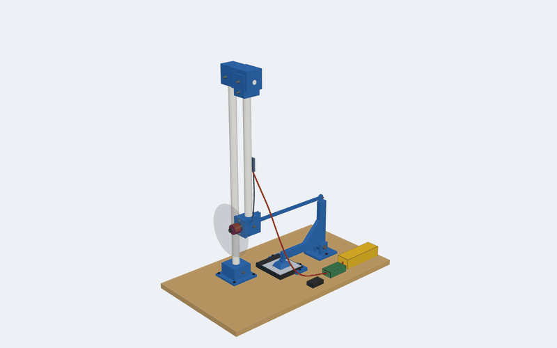
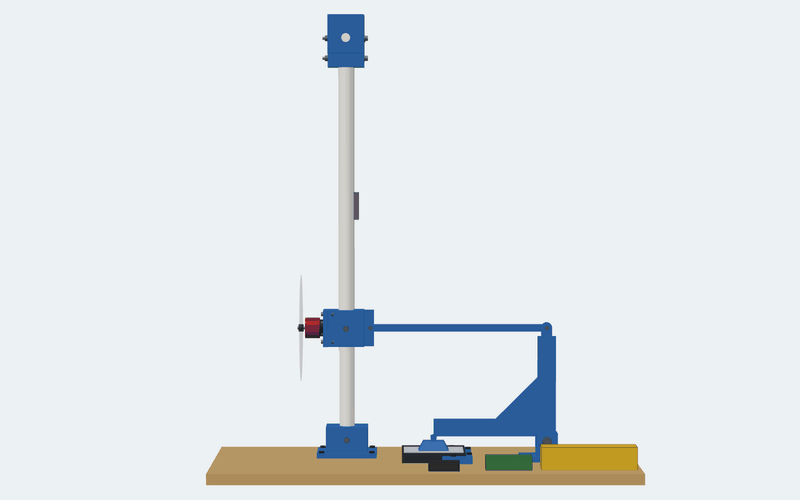
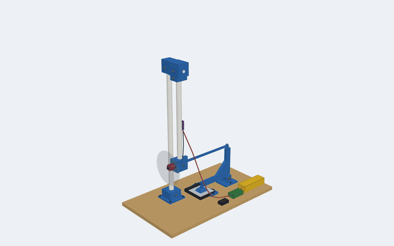
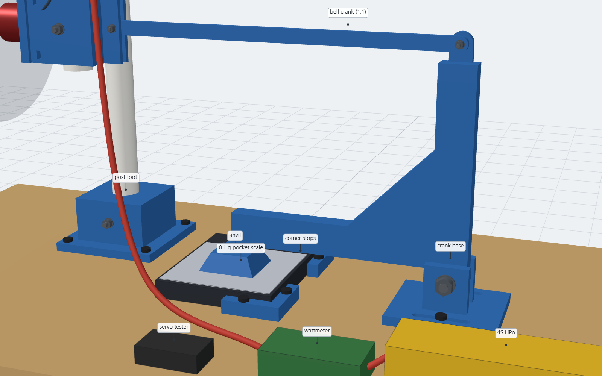
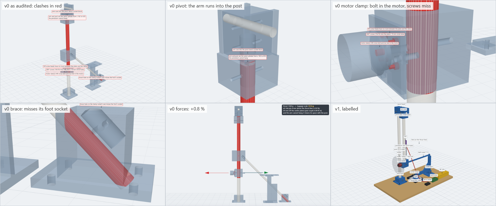
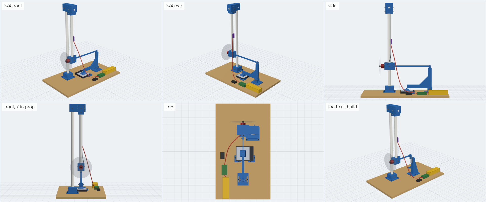
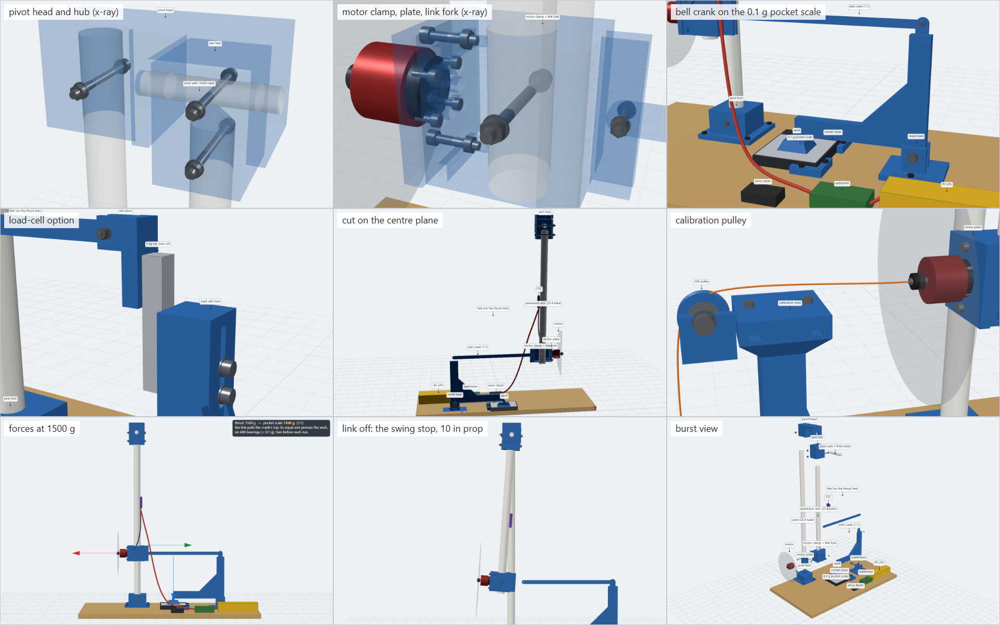
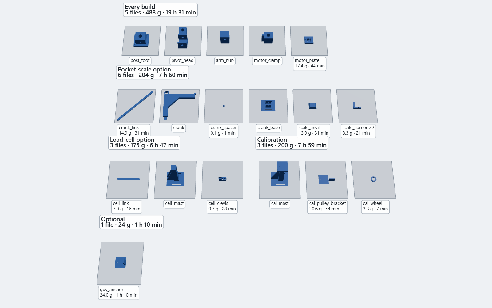
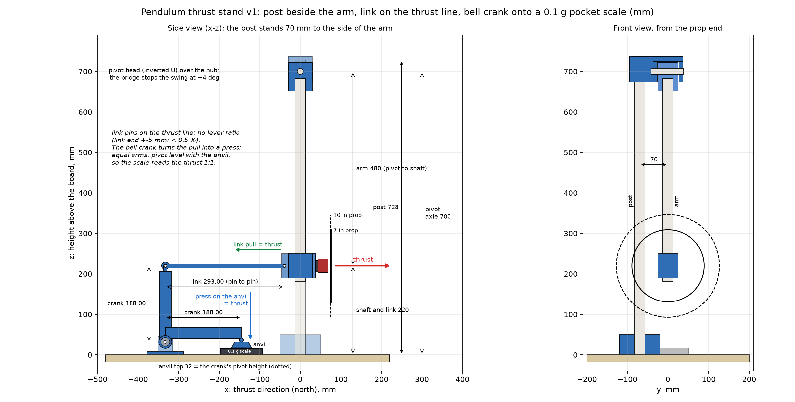

<div align="center">



# Pendulum thrust stand

### Hang the motor on a pendulum, hold it back on the thrust line, and read the thrust 1:1 on a 0.1 g kitchen scale


**[▶ Open the live 3-D viewer](https://ajayadahal.github.io/thrust-stand/)** ·
[Bill of materials](BOM.md) · [Design review](REPORT.md) · [Diagram](diagram.png)

</div>

Built for the VTOL project's motors (Emax ECOII 2807 1700KV, 7 in props) and for any 22xx/28xx
motor, from two 25.4 mm tubes and one 14.66 mm tube you already have, PETG parts, and either a
**0.1 g pocket kitchen scale** (YONCON 3000 g / 0.1 g; the same one weighs the VTOL's parts: see
"Weigh the VTOL's parts") or a 5 kg load cell.

Every part is generated by Python (build123d) from one parameter file, sliced from the command
line, and checked by a gate (collisions, bolt lengths, nut walls, motor patterns, the 1:1
geometry, swing stop, prop clearance, printability) before any filament is used.

**This is v1.** The first draft (v0, kept in `v0_archive/`) could not be assembled: its arm and
post stood on the same axis. Its audit found 19 issues, five of them blocking; v1 fixes 18 and
quantifies the last (the prop wash's bias), with a way to measure it. A second round replaced the
draft's luggage scale with a 0.1 g kitchen scale on a bell crank. `REPORT.md` has every finding
with its numbers; the viewer's "v0 draft as audited" mode shows the draft's clashes in red.

## At a glance

| | |
|---|---|
| **Principle** | Pendulum: the motor hangs 480 mm below a pivot; a link at shaft height holds it back. No lever ratio, so the link pulls with the thrust itself; a bell crank with equal arms turns that pull into a press on the scale, 1:1 |
| **Range** | up to ~2.9 kg of thrust (pocket scale: 3000 g × 0.1 g; load cell: 5 kg) |
| **Props** | 7 in (the VTOL's) to 10 in: the shaft is 220 mm above the board |
| **Error budget** | geometry ≤ 0.5 % (link end ±5 mm), pivot friction ≤ 2 g, crank bearings < 0.1 g, gravity < 1 g; the scale itself dominates |
| **Scale options** | A: 0.1 g pocket kitchen scale + bell crank (recommended; also weighs the VTOL's parts) · B: 5 kg bar load cell + HX711 + Arduino (logs, reads push and pull) |
| **Printed** | 5 core parts, 494 g, 21.2 h on the Kobra S1, + 209 g (A) or 178 g (B) |
| **Checked** | `scripts/check_stand.py`: 9/9 (collisions, bolts, nut walls, motor patterns, 1:1 geometry incl. the crank, swing stop, prop clearance, printability) |

## See it

<table>
<tr>
<td width="50%"><br>
<b>1:1.</b> The link's pull equals the thrust because both act at shaft height; the crank's equal arms pass it to the scale unchanged.</td>
<td width="50%"><br>
<b>Burst view.</b> Every part, tube and bolt moves out the way it goes together.</td>
</tr>
</table>





<details>
<summary><b>All sides, details and cuts</b></summary>
<br>



</details>

## Explore it in 3-D

**[Open the live viewer](https://ajayadahal.github.io/thrust-stand/)**, or run it locally:

```
pip install -r requirements.txt
python scripts/serve_viewer.py
```

then open <http://127.0.0.1:28766/viewer/>. Orbit, preset and close-up views, pocket scale or load
cell, prop size, the calibration rig, a thrust slider with the scale's reading, "link off" (the arm
swings to its stop), burst view, section cuts, x-ray, every print file on its bed, and **the v0
draft as audited** with its clashes in red. Hover for names, double-click to zoom. (three.js loads
from a CDN, so it needs internet.)

## How it works



The motor clamp sits at the bottom of a 480 mm arm that hangs from a pivot axle on top of the post.
Thrust pushes the arm north; a link from a fork on the clamp's back pulls it south. The link's pin
is **on the thrust line** (220 mm up, on the centre plane), so taking moments about the pivot,
link pull × 480 = thrust × 480: the link pulls with the thrust itself. No lever ratio needs
measuring, and the arm's length does not matter.

A kitchen scale only reads a push on its platform, so the link pulls the top of a **bell crank**
instead: an L that turns on two 608 ball bearings 32 mm above the board, one arm straight up to
the link (188 mm) and one arm north over the scale (188 mm). Its nose rests on `scale_anvil`, a
printed block standing on the centre of the scale's platform, whose top is level with the pivot.
Equal arms, so the nose presses with the link's pull: the scale reads the thrust 1:1. Because the
contact is level with the pivot, the nose moves straight down as the scale flexes and does not
scrub, and the bearings cost under 0.1 g at 2 kg. The crank's weight presses about 28 g and the
anvil weighs about 14 g: tare them. The anvil is what makes a 17 mm pocket scale fit: for another
scale, only the anvil changes (`BOM.md`).

Because thrust and link pull act on one line, the pivot carries only the pendulum's weight
(~420 g) and the post almost no sideways load: no brace is needed. The arm moves well under a
millimetre (the scale or the load cell barely flexes), so the pendulum's gravity adds less
than 1 g and pivot friction at most ~2 g.

The post stands 70 mm beside the arm (front view). The pivot head is an inverted U: its cheeks
carry the axle on either side of the hub, its bridge passes over the hub 2 mm clear, and the post's
socket sits beside it. That bridge is also a stop: if the link lets go at full throttle, the arm
swings 3.9° (the prop moves 33 mm) and stops, with a 10 in prop still 12 mm clear of the post.

## Tube cut list

| Piece | Stock | Cut |
|---|---|---|
| Post | 25.4 mm | 728 mm |
| Arm | 25.4 mm | 500 mm |
| Axle | 14.66 mm | 80 mm |

Measure your tubes before cutting. **Shorter tubes:** the post stands on the board and fills the
pivot head's socket, so the pivot axle ends up 28 mm below the post's top. The motor shaft stays at
220 mm (a 10 in prop needs ≥ 167 mm, a 7 in ≥ 130 mm), so the arm tube = post length − 228 mm
(500 for a 728 post). A 650 mm post, for example, gives a 422 mm arm, and the reading is still
1:1. To have the gate and the viewer follow, set `Z_PIVOT` (= post − 28) in
`scripts/build_thrust_stand.py` and run `scripts/build_all.py`.

## Print

Every part is PETG on the Kobra S1: 4 walls, 30 % gyroid, 0.2 mm, no supports anywhere. The
easiest way: open `3mf/<part>.3mf` in Anycubic Slicer Next, slice and send it to the printer. Each
project holds the part in its print orientation (two copies of `scale_corner`) with the Kobra S1
printer, the `PETG thrust stand` process and the `PETG @VTOL` filament (255 °C, bed 80 °C, the
same PETG as the VTOL project). The slicer warns that the 3MF has a customized filament preset:
click OK, its only custom G-code is two comment lines. `gcode/` has the same parts already sliced,
and `stl/` the bare meshes (orientation baked in; slice them as they are, for the Kobra X with its
own machine profile). Parts, masses and times: `BOM.md`. Print `pivot_head`, `arm_hub` and
`motor_clamp` first: they check the 25.8 mm and 15.0 mm bores against your tubes.

## Assemble

The arm is the north–south axis: the prop is at the north end, the scale to the south. "Right"
means looking north.

1. **Board.** Draw the centreline along the board's length. Mark the arm's axis on it 220 mm from
   the north edge. The post foot goes 70 mm to the right of that point. Option A: the crank's axle
   is 333 mm south of the arm's axis on the centreline, the centre of the scale's platform 145 mm
   south of it. Option B: the load-cell mast's centre is 222 mm south.
2. **Post.** Through `post_foot` until it stands on the board; screw the foot down (4 wood screws).
   Drill the 5 mm cross-hole through the post using the foot's hole as a guide; bolt (M5×80).
3. **Pivot head.** Ream its two 15 mm bores until the axle turns freely; add a drop of silicone
   grease. Push the head onto the post's top as far as it goes; drill through the post with its
   hole as a guide and bolt (M5×60), snug: the tubes are hollow.
4. **Hub and arm.** Push the arm into `arm_hub` up to the cone. Hold the hub between the cheeks
   and slide the axle in through the far cheek and the hub into the near cheek's blind bore. Drill
   the hub's two cross-holes, through the axle and through the arm, and bolt both (M5×70). With the
   link off, the arm must swing freely within its ±4° stop.
5. **Motor clamp.** Slide it up the arm's lower end, fork to the south, until its centre is 220 mm
   above the board (the arm ends ~8 mm below it). Drill through the arm sideways using the clamp's
   hole as a guide; bolt (M5×60).
6. **Motor and plate.** Slide an M4 nut into each of the clamp's side slots (they open on the side
   away from the post; push until the nut stops over its hole). Screw the motor to `motor_plate`
   first (M3×8, heads in the counterbores: diagonal slots for 19×19, cross slots for 22xx), then
   bolt the plate on (M4×20). Run the motor wires round the plate's edge and up the arm.
7. **Link.** Pin `crank_link` (option A) or `cell_link` (option B) in the fork (M3×20 + nyloc),
   snug but free to pivot.
8. **Scale, option A (pocket scale and bell crank).** Measure the scale first (`BOM.md`: the anvil
   assumes a 17 mm platform height). Press a 608ZZ into each face of `crank`. Hold the crank
   between the cheeks of `crank_base`, its tab to the right (east), with `crank_spacer` between the
   bearings, and push the M8×45 through (washer, cheek, bearing, spacer, bearing, cheek, washer,
   nut). Tighten: the bosses clamp only the inner races, so the crank still turns freely. Screw the
   base down loosely through its slots, axle on the centreline. Pin the link to the tab (M3×20 +
   nyloc, snug). Lay the scale down sideways, display to the east (right, looking north), the
   centre of its platform under the crank's nose; screw the two `scale_corner` stops to the board
   against its south-east and south-west corners, 1 mm clear. Stand `scale_anvil` on the
   platform's centre and lower the nose onto it. Slide the crank base along its slots until the
   arm hangs plumb with the crank's top arm vertical; tighten.
9. **Scale, option B (load cell).** Bolt the cell's fixed end to `cell_mast`'s north face (two
   M5×40 through the slot, two washers between mast and cell as a spacer), its arrow along the
   thrust axis. Bolt `cell_clevis` to the free end (M5×12, heads in the counterbores). Pin the
   link in the clevis (M3×20 + nyloc). Slide the mast until the arm hangs vertical with the cell's
   top 210 mm above the board (the pin then sits at 220); screw the mast down. Wire it as in
   `BOM.md`.
10. **Electronics.** Zip-tie the ESC to the arm's south side 400–450 mm up, out of the prop wash.
    Battery, wattmeter and servo tester go on the board, **never on the arm**; leave a slack loop in
    the lead from the board to the ESC so it cannot pull on the arm.

## Setup checks

- **Arm vertical, link level:** with no throttle the arm hangs plumb and the link is level.
- **Pivot free:** unhook the link and nudge the arm: it swings, settles, and stops at ±4°. If it
  sticks, ream the head's bores again.
- **Crank free (A):** lift the nose a few millimetres and let go: it drops back onto the anvil,
  and the reading returns to the same value within 0.1–0.2 g. Its horizontal arm is level and the
  nose sits on the anvil's top, not on its edge.
- **Prop clear:** turn the prop by hand: 131 mm above the board (7 in), clear of the post and the
  mast, nothing loose near the disc. Remove the calibration mast before running.
- **Zero:** tare the scale (or the cell) with the link connected and the motor stopped; the
  crank's ~28 g and the anvil's ~14 g go with it. A pocket scale also zeroes itself when it is
  switched on, so only switch it on with the motor stopped.

## Calibrate

Needed for the load cell, and a good check for the pocket scale: it tests the whole stand, not
just the scale. Take the prop off. Bolt `cal_pulley_bracket` onto `cal_mast` at the board's north
edge (its foot's north end on the edge) and set the board at the edge of the bench, so a weight
can hang past it. Tie braided line round the prop nut, run it level over the pulley (its groove
top is at shaft height) and hang known weights: 0, 0.5, 1.0, 1.5, 2.0 kg, then back down. Weigh
them on the pocket scale first (see "Weigh the VTOL's parts"): water bottles in a bag are fine once
you know them to 0.1 g.

- Load cell: the slope of reading against weight is the calibration factor for `set_scale()`.
- Pocket scale: the readings should match the weights to within a gram or two; the slope is the
  stand's own ratio (1.000 by design). That says nothing about the scale itself, which weighed
  the bottles: check it once with a calibration mass (1 kg should read 1000.0 ± 1 g) and use its
  calibration mode if its manual has one.
- The gap between the readings going up and coming down is the stand's friction: a few grams.

## Weigh the VTOL's parts

Lift the crank's nose a little, take the anvil off and slide the scale out of its corner stops;
the nose comes to rest on the board. Small parts go on the platform or in one of its trays (tare
the tray first); weigh tiny parts ten at a time. The battery or the whole plane (about 2.0 kg) go
on a light cradle that stands steadily on the 100 mm platform (a box or foam block, tared), with
the total under 3000 g. For the CG, rest the plane on two supports the same height, one of them on
the scale: CG from the other support = support spacing × scale reading ÷ total mass. To go back,
push the scale into both corner stops, stand the anvil on the platform's centre, lower the nose
and tare.

## Run a test

1. Clamp the board to the bench. Never hold the stand while it runs.
2. Stand to the side, never in the plane of the prop. Throttle at zero, a way to cut it ready.
3. Battery → wattmeter → ESC → motor; servo tester (or transmitter) to the ESC.
4. Step the throttle (25, 50, 75, 100 %), hold each step ~5 s, and write down thrust, voltage and
   current. The reading flickers with vibration: take the middle. Let the motor cool between
   full-throttle runs.
5. Repeat on a full pack and near empty: thrust goes roughly with voltage squared.

**VTOL pass marks** (from `vtol-plane/DESIGN.md` and `scripts/mass_balance.py`): each front
motor carries 741 g in hover and must stay under 60 % of its near-empty thrust, so the ECOII 2807
1700KV on a 7×4.5 needs **≥ 1235 g at ~14.0 V under load (3.5 V per cell)**. The mass balance
assumes 1250 g near empty and 1550 g on a full pack (the data sheet gives 1810 g at 16.8 V). The
rear motor carries 530 g in hover, so it needs ≥ 885 g. (v0's 1155 g / 880 g marks were for an
older 3S plan.)

**Reading the numbers.** Pulling (tractor), the prop blows onto the plate, the clamp and the
bottom of the arm, so the scale shows *installed* thrust, roughly 4–8 % under the free prop's
(estimate). For a pass/fail that errs on the safe side. With the load cell you can measure the
bias: flip the prop on the shaft and reverse the motor (swap two motor wires), so it pushes and the
wash blows away from the stand; the cell then reads in compression. The difference between the two
runs is the bias.

## Troubleshooting

- **Reading creeps during a run:** the pivot binds or the link rubs: ream the bores, check that
  the pins turn freely.
- **Reading jumps around:** balance the prop, check the motor screws, stop the board rocking; with
  the load cell, average more samples.
- **Reads with no throttle:** the link pulls the arm off vertical: slide the crank base (A) or the
  mast (B), re-zero.
- **Pocket scale went dark between runs:** it switches itself off when the reading stays still.
  Switch it back on with the motor stopped (it zeroes at switch-on), then run.
- **Reading lower than expected near the start of a slow ramp:** some kitchen scales track small
  slow changes near zero as drift. Tare, then step the throttle instead of creeping it up.
- **Thrust reads negative (load cell):** swap A+ and A− on the HX711, or flip the sign.
- **The arm sits on its stop:** the link is unhooked or too long, and the bridge is holding the arm.

## Safety

- A spinning prop can cause serious injury. Treat every run like a flight: clear area, no loose
  clothing or cables near the disc, throttle cut ready, never reach across the prop plane.
- Check the bolts before each session: motor screws, plate bolts, cross-bolts, link pin, mast.
- The calibration mast stands 60 mm in front of a 7 in prop: take it off before running.
- Do not push the pendulum arm towards the prop end with the scale in place: the crank passes your
  push to the 3 kg pocket scale 1:1.
- Stay within the motor's and the ESC's ratings and watch their temperature; the 50 A ESC suits
  the 2807 on 4S.
- Clamp the board down: 2 kg of thrust walks a loose board.

## Files and how they are made

```
scripts/build_thrust_stand.py   every dimension and part (build123d), the assembly, bolts, bought parts
                                -> stl/<part>.stl (print orientation) and stl/assembly.json
scripts/audit_v0.py             rebuilds v0 from v0_archive/ and measures its clashes -> v0_archive/audit/
scripts/check_stand.py          the gate: 9 checks, exit code 1 on any failure
scripts/slice_all.py            Anycubic Slicer Next CLI with the Kobra S1 profiles -> gcode/
scripts/export_3mf.py           slicer projects with the same settings -> 3mf/ (each re-sliced as a check)
scripts/make_viewer.py          viewer/manifest.json (parts, matrices, masses, bolts, v0 clashes)
scripts/make_diagram.py         diagram.png
scripts/serve_viewer.py         the viewer at :28766; ?capture=1 re-renders renders/*.png and *.gif
scripts/build_all.py            all of the above in order, stopping at the first failure
```

Python 3.11 with `requirements.txt`. After any change to `build_thrust_stand.py`, run
`python scripts/build_all.py` (`--no-slice` skips slicing; slicing needs Anycubic Slicer Next,
set `STAND_SLICER` if it is not in the default place), then refresh the renders with the viewer at
`http://127.0.0.1:28766/viewer/?capture=1` (`?capture=stills` skips the animations).
`v0_archive/` keeps the first draft (its STLs, renders, diagram, scripts and README) for reference.
